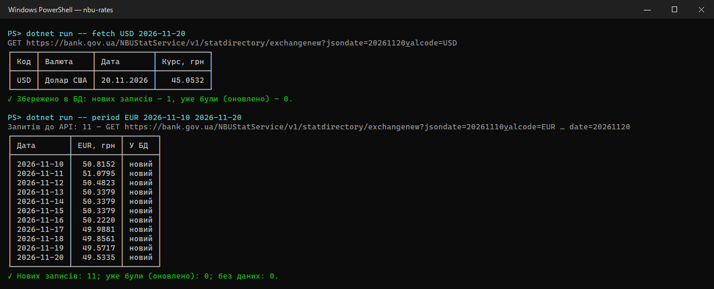
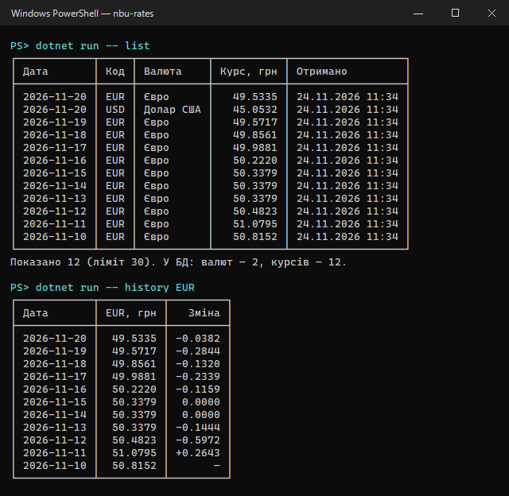

# Курси валют НБУ → SQLite (C#)

Консольний застосунок на C#/.NET 10: надсилає HTTP-запит до відкритого API Національного банку України,
показує отримані курси на екрані, зберігає їх у SQLite (2 таблиці, пов'язані зовнішнім ключем)
і виводить збережені дані з бази.

```
HTTP GET ?valcode=USD&date=20261120  →  JSON  →  екран  →  SQLite (currencies ─< rates)  →  SELECT … JOIN  →  екран
```

## Обране API

**Офіційний курс гривні до іноземних валют** — API НБУ, ключ не потрібен.
Документація: [bank.gov.ua/ua/open-data/api-dev](https://bank.gov.ua/ua/open-data/api-dev).

```
GET https://bank.gov.ua/NBUStatService/v1/statdirectory/exchangenew?json&valcode=EUR&date=20250901
```

| Параметр | Що робить | Приклад |
|---|---|---|
| `valcode` | літерний код валюти; без нього API повертає **всі** валюти | `USD`, `eur`, `PLN` |
| `date` | дата курсу у форматі `РРРРММДД` | `20261120` |
| `json` | відповідь у JSON (без нього — XML) | — |

Зміна `valcode` або `date` змінює відповідь. Приклад відповіді (з документації НБУ):

```json
[ { "r030": 978, "txt": "Євро", "rate": 48.196, "cc": "EUR", "exchangedate": "01.09.2025" } ]
```

`r030` — числовий код валюти, `txt` — назва, `rate` — курс у гривнях, `cc` — літерний код, `exchangedate` — дата курсу.
Готові запити для перевірки в редакторі/Postman — у файлі [`requests.http`](requests.http).

## Як виконані вимоги

| Вимога | Де і як |
|---|---|
| API з параметром, що змінює відповідь | `valcode` і `date` — [`NbuApiClient.BuildUrl`](src/NbuRates/Api/NbuApiClient.cs) |
| Запит із C# | один `HttpClient` на застосунок ([`Program.cs`](src/NbuRates/Program.cs)), `async/await`, `System.Text.Json` |
| Результат на екрані | таблиця з отриманими курсами + рядок запиту `GET …` |
| БД: 2 таблиці з FK | `currencies` 1 ─< ∞ `rates`, `rates.currency_id → currencies.id`, `PRAGMA foreign_keys = ON` — [`RatesRepository`](src/NbuRates/Data/RatesRepository.cs) |
| Вивід даних із БД | `SELECT … JOIN`, історія зі зміною за день (`LAG`), статистика (`COUNT/MIN/MAX/AVG … GROUP BY`) |
| Параметризовані SQL-запити | усі значення лише через `$параметри` і `Parameters.AddWithValue`, без конкатенації; є тест на `' OR '1'='1` |
| Помилки: статус ≠ 200 | `ApiErrorKind.HttpStatus` — повідомлення з кодом статусу |
| Помилки: немає мережі | `HttpRequestException` → `ApiErrorKind.Network`; тайм-аут → `ApiErrorKind.Timeout` |
| Помилки: порожня відповідь | порожнє тіло → `EmptyResponse`, порожній масив `[]` → `NoData`, зламаний JSON → `InvalidJson` |
| Ключі й налаштування — не в коді | адреса API, тайм-аут, рядок підключення — у `appsettings.json`, перевизначаються змінними середовища або `appsettings.Local.json` (у `.gitignore`) |
| Повторний запит не створює дублікатів | `UNIQUE (currency_id, rate_date)` + `INSERT … ON CONFLICT DO UPDATE` (upsert) — повторний запит лише оновлює курс; програма показує «нових записів — 0» |

## Структура БД

```sql
CREATE TABLE currencies (
    id    INTEGER PRIMARY KEY AUTOINCREMENT,
    r030  INTEGER NOT NULL,          -- 840
    code  TEXT    NOT NULL UNIQUE,   -- USD
    name  TEXT    NOT NULL           -- Долар США
);

CREATE TABLE rates (
    id          INTEGER PRIMARY KEY AUTOINCREMENT,
    currency_id INTEGER NOT NULL REFERENCES currencies (id) ON DELETE CASCADE,  -- FK
    rate_date   TEXT    NOT NULL,    -- 2026-11-20
    rate        REAL    NOT NULL CHECK (rate > 0),
    fetched_at  TEXT    NOT NULL,    -- коли отримано, UTC
    UNIQUE (currency_id, rate_date)  -- один курс валюти на день
);
```

Зв'язок **один-до-багатьох**: одна валюта має багато курсів (по одному на кожен день), кожен курс належить одній валюті.

## Запуск

Потрібен [.NET 10 SDK](https://dotnet.microsoft.com/download) (перевірити: `dotnet --version`).
Пакети NuGet (`Microsoft.Data.Sqlite`, `Microsoft.Extensions.Configuration.*`) завантажаться автоматично.

```bash
git clone <посилання на цей репозиторій>
cd nbu-rates
dotnet run --project src/NbuRates
```

Без аргументів відкривається меню:

```
  1  Курс валюти на дату           API → екран → БД
  2  Усі курси на дату             API → екран → БД
  3  Курс валюти за період         API → екран → БД
  4  Збережені курси               БД → екран
  5  Історія валюти зі зміною      БД → екран
  6  Статистика по валютах         БД → екран
  0  Вихід
```

Те саме — командами:

```bash
dotnet run --project src/NbuRates -- fetch USD 2026-11-20      # API → екран → БД
dotnet run --project src/NbuRates -- fetch USD 2026-11-20      # повторно: нових записів — 0
dotnet run --project src/NbuRates -- fetch-all 2026-11-20      # усі валюти на дату
dotnet run --project src/NbuRates -- period EUR 2026-11-01 2026-11-20
dotnet run --project src/NbuRates -- list USD                  # з БД
dotnet run --project src/NbuRates -- history USD               # з БД, зміна за день
dotnet run --project src/NbuRates -- stats                     # з БД, агрегати
```

Дата — `РРРР-ММ-ДД` або `ДД.ММ.РРРР`; без дати — сьогодні. Файл БД `nbu_rates.db` створюється в поточній папці
(повний шлях програма показує при старті). Переглянути його можна в DB Browser for SQLite, SQLiteStudio, DBeaver або:

```bash
sqlite3 nbu_rates.db "SELECT c.code, c.name, r.rate_date, r.rate FROM rates r JOIN currencies c ON c.id = r.currency_id ORDER BY r.rate_date DESC;"
```

> Якщо встановлено лише .NET 8 SDK: замініть `net10.0` на `net8.0` в обох `.csproj`.

## Налаштування

[`src/NbuRates/appsettings.json`](src/NbuRates/appsettings.json):

| Ключ | За замовчуванням | Змінна середовища |
|---|---|---|
| `NbuApi:BaseUrl` | `https://bank.gov.ua/NBUStatService/v1/statdirectory/exchangenew` | `NbuApi__BaseUrl` |
| `NbuApi:TimeoutSeconds` | `10` | `NbuApi__TimeoutSeconds` |
| `ConnectionStrings:Sqlite` | `Data Source=nbu_rates.db` | `ConnectionStrings__Sqlite` |
| `App:MaxPeriodDays` | `31` | `App__MaxPeriodDays` |
| `App:RequestDelayMs` | `250` (пауза між запитами за період) | `App__RequestDelayMs` |
| `App:ListLimit` | `30` (рядків у виводі з БД) | `App__ListLimit` |

Порядок пріоритету: `appsettings.json` → `appsettings.Local.json` → змінні середовища.
Для API, якому потрібен ключ, його кладуть у `appsettings.Local.json` або змінну середовища — обидва варіанти не потрапляють у git.

```powershell
# PowerShell: інший файл БД без зміни коду
$env:ConnectionStrings__Sqlite = "Data Source=C:\temp\rates.db"; dotnet run --project src/NbuRates -- list
```

## Тести

```bash
dotnet test
```

46 тестових випадків (xUnit), мережа не потрібна — HTTP підміняється власним `HttpMessageHandler`:

- **API-клієнт**: розбір JSON, параметри в URL, статуси 400/404/429/500/503/204, порожнє тіло, `[]`, XML/зламаний JSON замість очікуваного, відсутність мережі, тайм-аут;
- **БД** (тимчасовий файл SQLite): наявність FK, FK відхиляє курс неіснуючої валюти, повторне збереження без дублікатів, оновлення курсу, JOIN, `LIMIT`, спроба SQL-ін'єкції, `LAG`, агрегати;
- **Введення**: коди валют і формати дат.

Тести також запускаються в GitHub Actions при кожному push ([`.github/workflows/ci.yml`](.github/workflows/ci.yml)).

## Docker

```bash
docker build -t nbu-rates .
docker run --rm -it -v nbu-data:/data nbu-rates                  # меню
docker run --rm -v nbu-data:/data nbu-rates fetch USD 2026-11-20  # команда
docker run --rm -v nbu-data:/data nbu-rates list
```

БД лежить у томі `nbu-data` і зберігається між запусками.

## Структура репозиторію

```
nbu-rates/
├─ src/NbuRates/
│  ├─ Program.cs              точка входу: налаштування, HttpClient, БД
│  ├─ App.cs                  меню та команди
│  ├─ Api/NbuApiClient.cs     HTTP-запит, розбір JSON, обробка помилок
│  ├─ Data/RatesRepository.cs схема БД, upsert, SELECT/JOIN/LAG/GROUP BY
│  ├─ Config/AppConfig.cs     читання й перевірка налаштувань
│  └─ appsettings.json
├─ tests/NbuRates.Tests/      xUnit-тести
├─ requests.http              запити до API для редактора/Postman
├─ Dockerfile
└─ .github/workflows/ci.yml
```

## Скриншоти

| Запит до API і збереження | Повторний запит — без дублікатів | Дані з БД |
|---|---|---|
|  |  |  |
